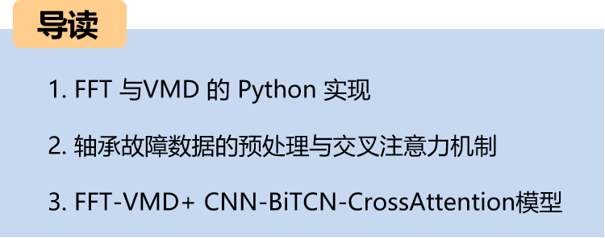
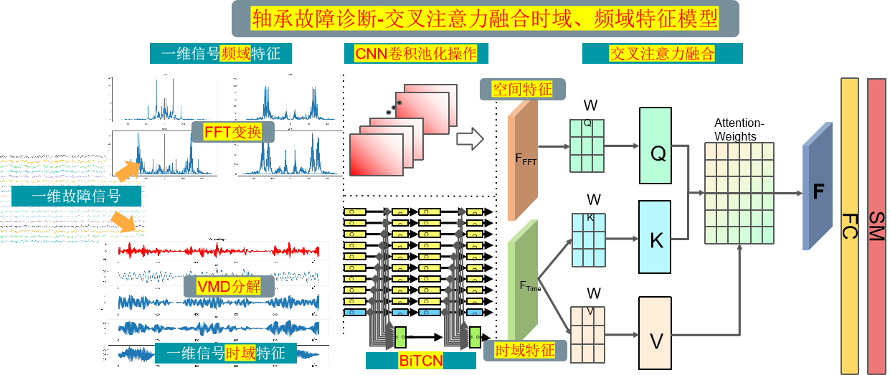
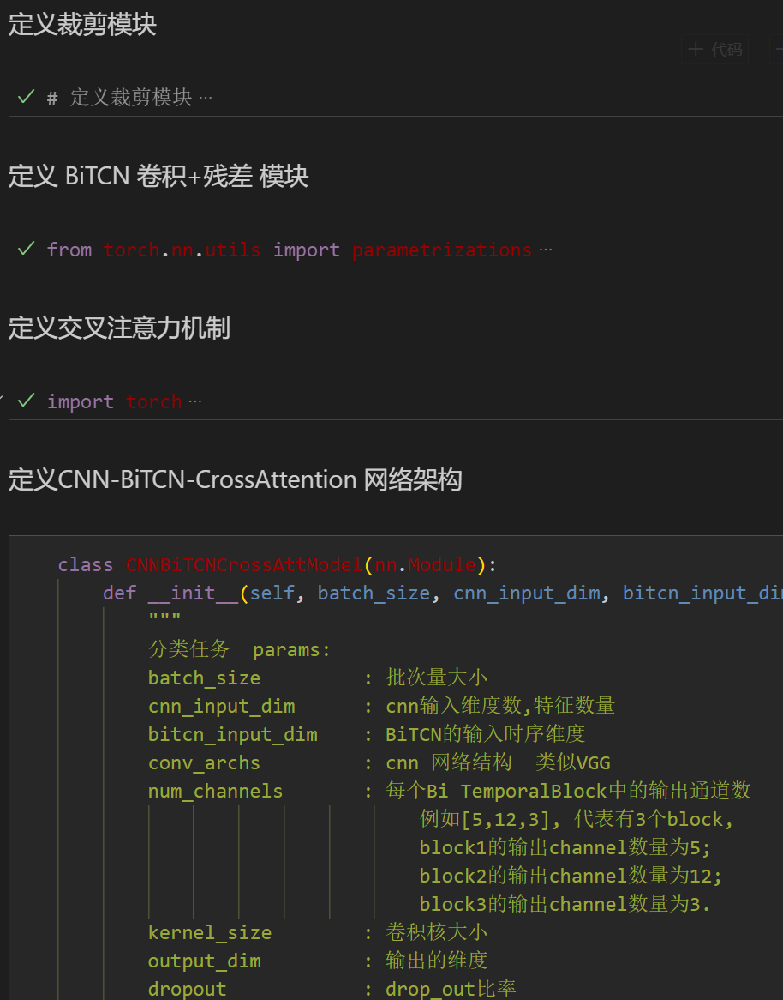
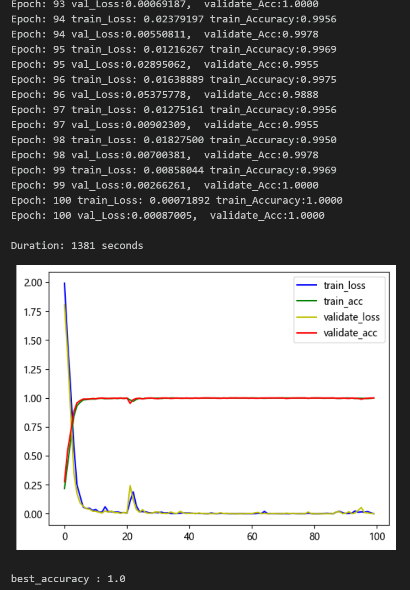
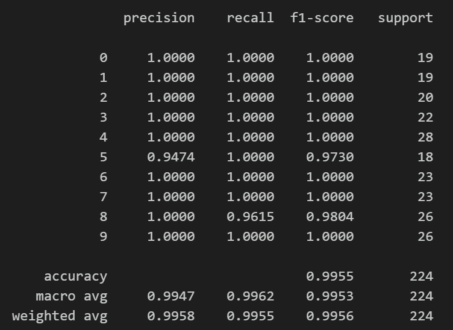
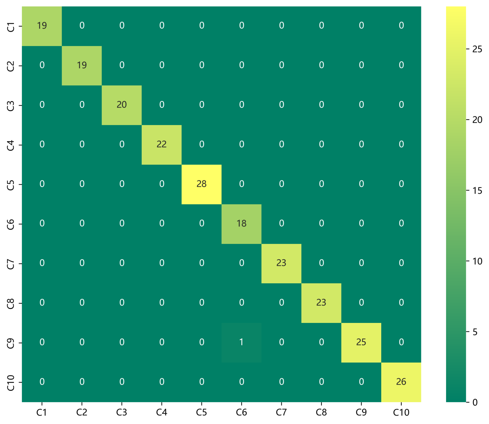

# Python Bearing Fault Diagnosis (20) High-Innovation Fault Identification Model (III)

Recommendation - Family Kit, with higher cost-performance ratio! ● Data set: CWRU West Reserve University bearing dataset, Harbin Institute of Technology Aerospace Engine Bearing Dataset
● Environment framework: Python 3.9, PyTorch 1.8 and above versions can run
● Accuracy: Test set 99%
● Usage object: Paper requirements, graduation design requirements
● Code guarantee: The code is detailed with comments, ready to run without modification.
The family kit includes the following content:
- Complete bearing fault dataset, as well as pre-generated fault signal dataset, classification data, and label sets, all of which can be run, and there are also examples of Fast Fourier Transform (FFT)
- 50 epochs, accuracy 99%, the FFT-VMD+CNN-BiTCN-CrossAttention network achieves significant classification results, the model can fully extract the spatial and temporal features and frequency domain features of bearing fault signals, converges quickly, and has excellent performance, which is currently the highest accuracy method among previous articles. Innovation is also!!!
- Includes code for data preprocessing and FFT, VMD, CNN-BiTCN-CrossAttention classification
- Environment: Python 3.9
- Note: We also have accompanying models explanation (helpful for learning network structure) and parameter tuning explanation! For those who need a graduation project or a small paper, this is essential, with rich modules and high innovation and performance!!
Innovation is high, effect is obvious!! Innovation points:
1. Preprocessing part: combining Fast Fourier Transform (FFT) and Variational Mode Decomposition (VMD) for signal time-frequency and domain feature extraction, capable of mining multi-scale features in fault signals;
2. Then using CNN Convolutional Neural Network to extract spatial features of multi-scale features after preprocessing fault signals, and BiTCN to extract time-domain features of multi-scale features after preprocessing fault signals.
3. Ultimately, the integration of spatiotemporal features is achieved through cross-attention, thereby enhancing the representational capabilities of features for fault signal recognition.
Preface:
This article preprocesses data from the CWRU bearing dataset using Fast Fourier Transform (FFT) and Variational Mode Decomposition (VMD), and finally implements a spatiotemporal feature fusion model based on Cross Attention, CNN-BiTCN-CrossAttention, to classify fault data. For a detailed introduction to the CWRU bearing dataset, please refer to the following text:
Python-CWRU Bearing Data Interpretation and Classification Processing
1. Model Overall Structure:
\t1.1 The overall structure of the model is as follows:
\n        \n
The one-dimensional fault signals are processed separately through FFT transformation and VMD decomposition, then stacked after the transformation and decomposition results. Through CNN and BiTCN networks, spatial and temporal features are extracted. Finally, the attention mechanism is used to fuse the time-domain and frequency-domain features. By calculating attention weights, the model can focus more on important features, improving model performance and generalization capability.
\t1.2 Innovative Points in Details:
\tWhen processing fault signals, extracting time-frequency domain features is very important. Combining Fast Fourier Transform (FFT) and Variational Mode Decomposition (VMD) can effectively mine multi-scale features from the signal.
\t(1) Preprocessing - FFT:
\tFFT is a widely used method for frequency domain analysis, which converts signals from the time domain to the frequency domain to obtain the signal's spectral information. Through FFT, we can get the energy distribution of the signal at different frequencies, thereby understanding the frequency components of the signal. However, FFT only provides the signal's spectral information at a certain moment, unable to reflect the signal's temporal changes.
\t(2) Preprocessing - VMD:
To address this issue, Variational Mode Decomposition (VMD) can be introduced. VMD is a mode decomposition method based on signal adaptive adjustment, which can decompose the signal into a series of mode functions, each representing the characteristics of the signal at different scales. Through VMD, we can obtain the time-domain feature information of the signal at different scales.
(3) Preprocessing—Feature Fusion:  
Combining FFT and VMD, we can first use FFT to convert the signal into the frequency domain, obtaining the spectrum information of the signal. Then, simultaneously applying VMD to the faulty signal, it can be decomposed into a series of mode functions. These mode functions represent the time-domain characteristics of the signal at different scales. By analyzing these information, we can mine the multi-scale features of the faulty signal, thereby better understanding the time-frequency characteristics of the signal. This method can analyze signals more comprehensively, aiding in signal processing tasks such as fault detection and diagnosis. We fuse the multi-scale features extracted by FFT and VMD as input to an innovative network model for training.
(4) Innovative Network Model—CNN Spatial Feature Extraction:  
Input: Fused FFT, VMD features  
Operation: Convolution and pooling operations are performed on each input feature to extract spatial features  
Output: The convolution pooling features representation, used to capture vibration spatial features at different frequencies  

(5) Innovative Network Model—BiTCN Time Series Feature Extraction:  
Input: Fused FFT, VMD features  
Operation: BiTCN network learns sequence information, focusing on important time-series features  
Output: The time-series feature representation after BiTCN processing, with better fault signal time-series modeling capability  
(5) Multi-Scale Feature Fusion—Cross Attention Mechanism Feature Fusion:  
Input: The spatial features extracted by CNN, the time-series features extracted by BiTCN
Cross-attention mechanism: Utilizes cross attention to fuse features from both time and frequency domains. By calculating attention weights, the model can focus more on important features, enhancing model performance and generalization capabilities.
2. Preprocessing of bearing fault data
2.1 Data importation
Referencing previous articles, preprocessing for fault classification with 10 categories is performed. The Case Western Reserve University bearing dataset for 10-class classification includes:
train_set, val_set, test_set, which are divided into training set, validation set, and test set in a ratio of 7:2:1, and finally saved the data.
2.2 Fault FFT transformation visualization
2.3 Fault VMD decomposition visualization
2.4 Creation of feature preprocessing datasets for fault data
3. Cross-attention mechanism
3.1 Concept of Cross attention
In the Transformer architecture, an attention mechanism that mixes two different embedding sequences is implemented.
Both sequences must have the same dimensionality.
The two sequences can be of different patterns (e.g., text, sound, image).
One sequence serves as input Q, defining the output sequence length, while the other provides input K&V.
3.2 Cross-attention algorithm
With two sequences S1 and S2,
Calculate S1's K, V
Calculate S2's Q
Based on K and Q calculate the attention matrix
Apply V to the attention matrix
Output sequence length consistent with S2
During the fusion process, spatial features obtained through CNN convolutional pooling operations are used as query sequences, while BiTCN outputs temporal features serve as key-value pairs sequences. By calculating the attention weights between the query sequence and the key-value pair sequences, we can model the degree of association between different features.
4. FFT-VMD+CNN-BiTCN-CrossAttention for Bearing Fault Diagnosis Classification
4.1 Define the FFTVMD+CNN-BiTCN-CrossAttention classification network model
4.2 Set parameters and train the model
50 epochs, accuracy 100%, the FFTVMD+CNN-BiTCN-CrossAttention network has a significant classification effect, Fast Fourier Transform (FFT) and Variational Mode Decomposition (VMD) can effectively mine multi-scale features from signals, the innovative model can fully extract spatial and temporal features of bearing fault signals, converges quickly, has excellent performance, high accuracy, cross attention mechanism can model the degree of association between different features, extract important features from fault signal frequency domain and time domain characteristics, the effect is obvious, with high innovation!
Note: Adjust parameters:
- You may increase the number of CNN layers and hidden layer dimensions, adjust learning rate;
- Adjust the number of BiTCN layers and channel count per layer, increase more epochs (note to prevent overfitting);
- Change the shape of one-dimensional signal stacking (set appropriate length and dimension);
- 4.3 Model evaluation
- Accuracy, Precision, Recall, F1 Score
- Fault classification confusion matrix:
- Previously interesting content:
Python-Case Western Reserve University (CWRU) bearing data interpretation and classification processing
Python bearing fault diagnosis (I) Short-time Fourier Transform STFT
Python bearing fault diagnosis (II) Continuous Wavelet Transform CWT
Python bearing fault diagnosis (III) Empirical Mode Decomposition EMD
Pytorch-LSTM bearing fault one-dimensional signal classification (I)
Pytorch-CNN bearing fault one-dimensional signal classification (II)
Pytorch-Transformer bearing fault one-dimensional signal classification (III)
Python Bearing Fault Diagnosis (IV) Failure Classification Based on EMD-CNN
Python Bearing Fault Diagnosis (5) Fault Classification Based on EMD-LSTM
Python Bearing Fault Diagnosis (VI) Failure Classification Based on EMD-Transformer
Python Bearing Fault Diagnosis (VII) - Fault Classification Based on EMD-CNN-LSTM
Python Bearing Fault Diagnosis (Part 8) - Fault Classification Based on EMD-CNN-GRU Parallel Model
Bearing Fault Identification Model Based on FFT + CNN - BiGRU-Attention for Time and Frequency Feature Attention Fusion
Bearing Fault Identification Model Based on FFT + CNN - Transformer Time-Domain and Frequency-Domain Feature Fusion
Python Bearing Fault Diagnosis (IX) Fault Classification Based on VMD+CNN-BiLSTM
Python Bearing Fault Diagnosis (10) Fault Classification Based on VMD+CNN-Transformer
Python Bearing Fault Diagnosis (11) Based on VMD+CNN-BiGRU-Attenion for Fault Classification
Cross Attention FFT + CNN - BiLSTM-CrossAttention Bearing Fault Identification Model
Cross Attention Fusion of Time-Domain and Frequency-Domain Features for Bearing Failure Identification Model with FFT + CNN-Transformer-CrossAttention
Python Bearing Fault Diagnosis Beginner Tutorial
Python Bearing Fault Diagnosis (13) Super-strong Machine Learning Recognition Model Based on Fault Signal Feature Extraction
Python Bearing Fault Diagnosis (14) High-Innovation Fault Identification Model
Python Bearing Fault Diagnosis (15) - One-Dimensional Fault Signal Identification Model Based on CNN-Transformer  
Python Bearing Fault Diagnosis (16) - High Innovation Fault Identification Model II  
 | Science Citation Index 1 Region, High Innovation Bearing Fault Diagnosis Model!
Python Bearing Fault Diagnosis (18) - Innovative Diagnosis Model Based on CNN-TCN-Attention  
Based on GADF+Swin-CNN-GAM, High Innovation Bearing Fault Diagnosis Model  
Attention Magic Modification | Superior Bearing Fault Diagnosis Model!  
Bearing Fault—Cross Attention Innovative Model Full Set  
Python Bearing Fault Diagnosis (19) - Innovative Diagnosis Model Based on Transformer-BiLSTM  
END  
\t2. Friends who like this can click to follow, give the article a "like", share in WeChat Moments or discuss groups.

## Images

<!-- PAYMENT_BLOCK -->

## Get this dataset

- Payment link (Stripe): [Buy now](https://buy.stripe.com/3cs8yP7sY87d0vu9AB)
- Payment QR code: 

<!-- /PAYMENT_BLOCK -->
